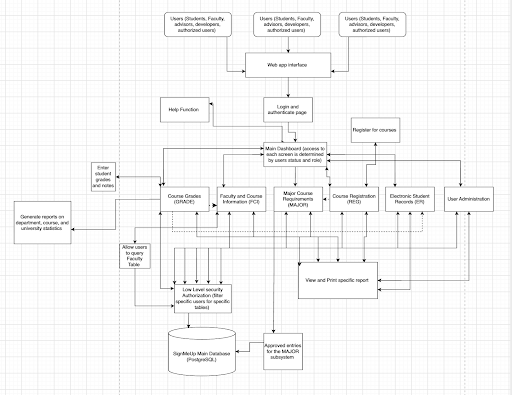

# SignMeUp

An application which will help students and staff nagivate course registration, student records, class information, faculty information, and student grades

## Developed by the 'Help Wanted Team'

```
Project Manager: Isha Shekhar

Configuration Manager: Elijah Uy

Software Manager: Amy Tran

Database Manager: Natalie Petersen

Test Manager: Justin Ogden

Software Developer: Anirudh Jha
```

## File Structure

```
SignMeUp/
├── README.md
├── database/
│    └── cs532_databasediagram.png
│    └── cs532_databasescript.sql
│
├── backend/
│   ├── src/
│   │   └── server.js
│   │   └── config
│   │       └── db.js
├── frontend/
│   ├── signmeup/
│   │   └── index.html
│   │   └── src
│   │       └── pages
│   │           └── LoginPage.css
│   │           └── LoginPage.jsx
│   │       └── App.jsx
│   │       └── index.css
│   │       └── main.jsx
├── docs/
│   ├── Systems_architecture/
│   │   └── Sw_arch_532.png
│   ├── Uml/
│   │   └── use-case-diagram.png
│   ├── database/
│   │   └── cs532_databasediagram.png
│   ├── requirements/
│   │   └── Requirements.md
│   ├── tests/
│   │   └──Test methods and data.md
│   └── UI_wireframes/
│       └── wf_1.png
│       └── wf_2.png
│       └── wf_3.png


```

## Systems Architecture



## Updated prototype quick start

The current prototype can be demonstrated without a database. Open two PowerShell terminals from the project root.

```powershell
cd .\frontend\signmeup
npm install
npm run dev
```

Open the Vite URL, normally `http://localhost:5173`, and use one of the demo accounts shown on the login screen. Prototype changes are saved in browser localStorage. Use **Reset demo data** on the Overview screen to return to the seed data.

The PostgreSQL API is optional for the browser prototype. To run it after setting a connection string:

```powershell
cd .\backend
npm install
$env:DATABASE_URL = "your_postgresql_connection_string"
npm start
```

The API exposes `/health`, `/health/database`, `/api/authorizedusers/login`, `/api/authorizedusers`, and `/students`. The database script in `database/cs532_databasescript.sql` creates the subsystem schemas and tables for a new PostgreSQL database.

See `docs/requirements/Implementation status.md` for the requirement-to-feature mapping and the remaining deployment boundaries.
